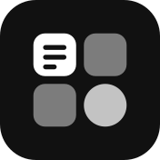
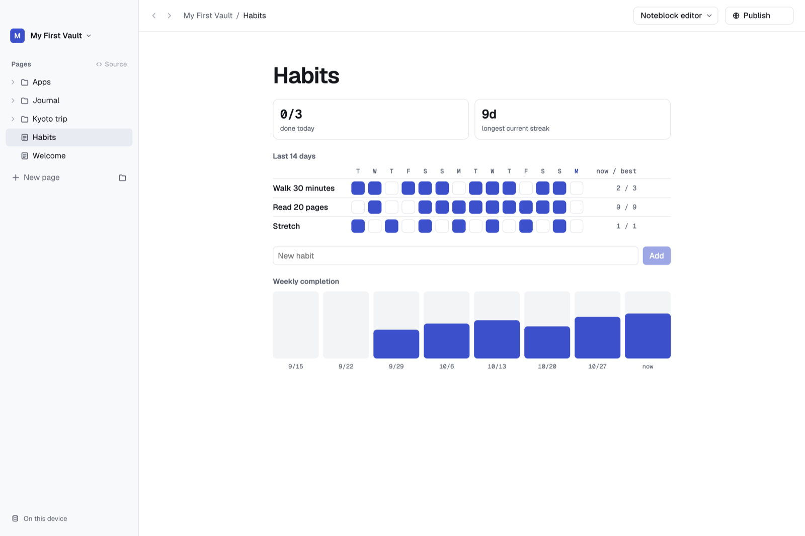
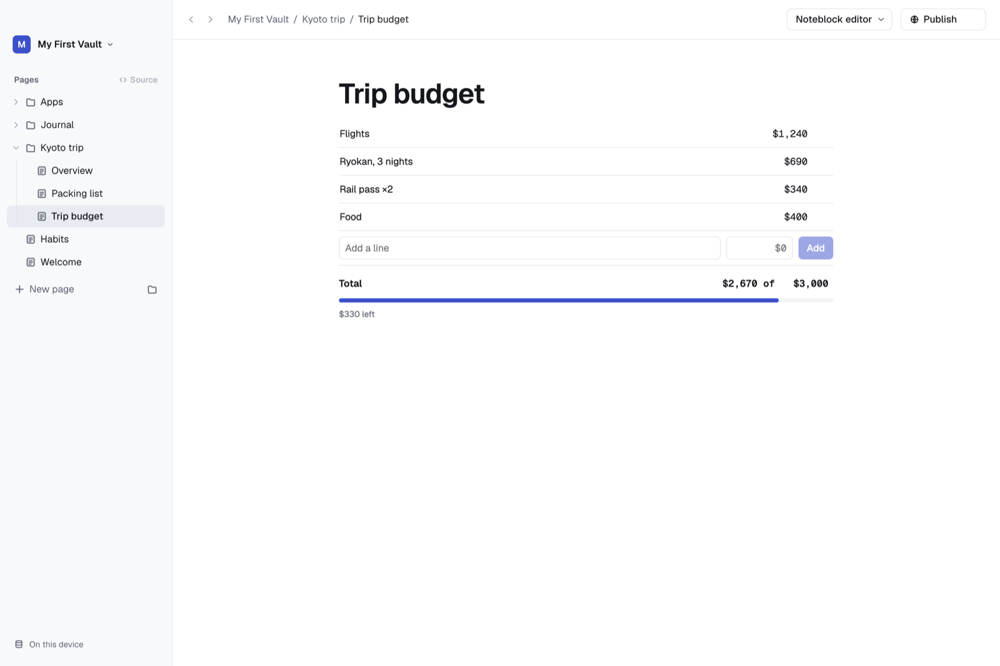
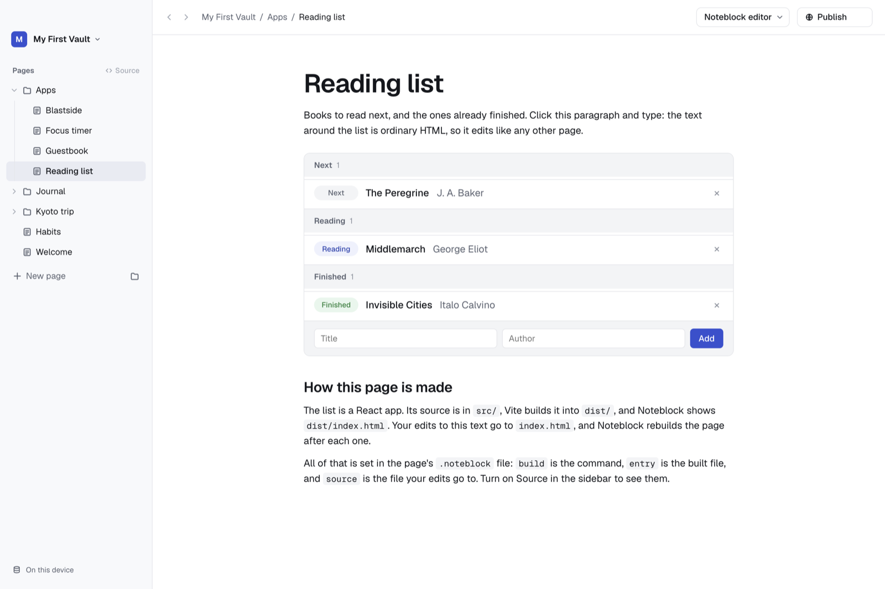

<div align="center">
  
  <h1>Noteblock</h1>
  <p><strong>Notes where any page can become a small app.</strong><br>
  A local-first notes app for the Mac and Windows. Every page is a folder of HTML, so a note can grow into a tracker, a dashboard or a game, with its own data.</p>
  <p><a href="https://noteblock.ai">noteblock.ai</a> · <a href="#download">Download</a> · <a href="#build-from-source">Build from source</a> · <a href="#self-host">Self-host</a></p>
  <p>
    <a href="LICENSE.md"></a>
    
  </p>
</div>

<a href=".github/media/habits.png"></a>
<p align="center"><sub>A page is just HTML in a folder. This habit tracker keeps its data in its own SQLite file.</sub></p>

## What it does

- **Pages that run.** Write a note, then add a script and it becomes an app. React, Vite builds and plain HTML all work.
- **Data per page.** Each page gets its own SQLite database through a small `quire.store` API.
- **Backends when you need one.** A page can start its own server (`backend/`), with a fixed port and secrets kept out of git.
- **Built for agents.** The `noteblock` CLI, an MCP server and a Claude Code skill let an agent edit a page while you watch.
- **Plain files, in git.** A vault is a folder on your disk and a git repo. Every edit is a commit.
- **Publish.** Put any page on the web with one click.
- **Import from Obsidian.** Markdown, links, embeds and images come across.

| Trip budget | Reading list |
|---|---|
|  |  |
| A few lines of JavaScript turn a list into a budget. | A React app with a Vite build, edited like any other page. |

Every screenshot is from the example vault that ships with the app.

## Download

Get the signed app for [macOS](https://noteblock.ai/download/mac) (Apple silicon and Intel) or [Windows](https://noteblock.ai/download/windows). It updates itself. Noteblock is free; [Pro](https://noteblock.ai/pricing) adds more published sites and AI credits.

---

## How pages work

A vault is a folder on your disk, and every page is a folder inside it:

```
~/Quire/My First Vault/       one vault = one git repo
  .noteblock/vault.json       vault name and format version
  Kyoto trip/                 a folder: groups pages
    Trip budget/              a page: any folder with a .noteblock file
      .noteblock              {"id", "entry": "index.html"}
      index.html              the page
      app.js, style.css       its code and assets
      data/<you>.sqlite       this page's data (not in git)
```

Pages don't hold pages, so anything inside a page folder is that page's own files. A page can also run its own server: put the code in `backend/` and the command in `.noteblock` (`"backend": {"run": {"api": "node server.js"}}`). The page's `fetch("api/…")` reaches it.

## Agents

Outside agents such as Claude Code can edit pages too. They use the CLI to lock a page, change its files and commit:

```bash
noteblock edit "Kyoto trip/Trip budget" -m "Add a who-paid column"   # lock; prints the folder
# …edit files…
noteblock done "Kyoto trip/Trip budget"                              # unlock and commit
```

The app shows the page as being edited and swaps in the new version when the agent finishes. The same verbs are available over MCP (`mcp/server.mjs`), and `skills/noteblock/SKILL.md` teaches Claude Code the workflow.

## Build from source

You need [pnpm](https://pnpm.io) and Node 22+.

```bash
pnpm install
pnpm dev          # Noteblock Dev, with a seeded example vault
pnpm check        # syntax checks, smoke tests and the build
```

Noteblock Dev has its own settings (`~/.noteblock-dev`) and vault (`~/Quire/Dev Vault`), so it never touches an installed copy. To install your build:

```bash
pnpm install-app  # builds the app and copies it to /Applications
pnpm setup-cli    # puts `noteblock` on your PATH (~/.local/bin)
```

## Self-host

The editor also runs as a plain Node server, so a machine you own can serve a vault to your other devices:

```bash
pnpm build
pnpm web --vault ~/Quire/Work --port 4790 --token-file ~/.noteblock/web-token
```

It binds to `127.0.0.1` and needs the token on every request. Put it behind something private such as `tailscale serve`, never on the open internet. [`docs/web-host.md`](docs/web-host.md) has the flags, the routes and the security model. Vault sync is plain git: point the vault's `origin` at any private repo.

## Documentation

| Topic | Where |
|---|---|
| The page format and every API a page can call | [`docs/contract.md`](docs/contract.md) |
| How agent edits, locks and commits work | [`docs/agents.md`](docs/agents.md) |
| Running the editor on a server | [`docs/web-host.md`](docs/web-host.md) |
| The publishing API | [`docs/hosting-api.md`](docs/hosting-api.md) |
| Design decisions | [`docs/decisions/`](docs/decisions/README.md) |
| Trust model and reporting a vulnerability | [`SECURITY.md`](SECURITY.md) |

Noteblock was called Quire, and some internal names still are: `~/Quire` and the `quire` command, which works beside `noteblock`.

## Contributing

See [CONTRIBUTING.md](CONTRIBUTING.md). Run `pnpm check` before opening a pull request.

## License

[FSL-1.1-ALv2](LICENSE.md), the Functional Source License. You can use, read, change and self-host Noteblock for anything except a competing commercial product. Each release becomes Apache-2.0 two years after it ships.
